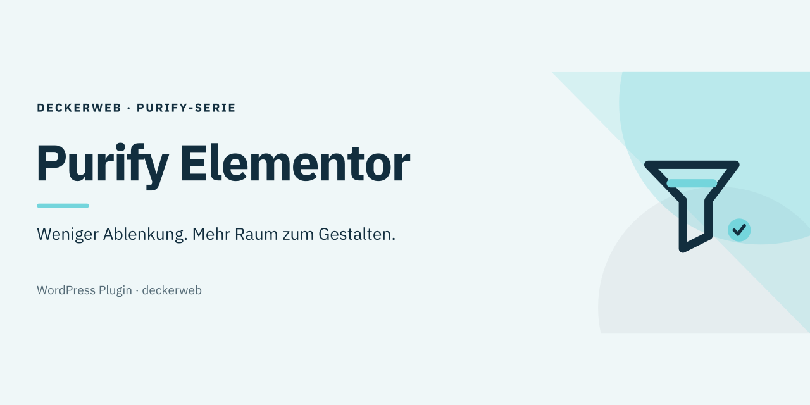

# Purify Elementor

Eine ruhigere Elementor-Oberfläche. Geprüfte Werbung ausblenden und die Navigation vereinfachen; Inhalte und gespeicherte Elementor-Einstellungen bleiben erhalten.

[English](README.md) · Version 1.1.1 · WordPress 6.7+ · PHP 8.1+

[Download](https://github.com/deckerweb/purify-elementor/releases/latest) · [FAQ](docs/FAQ.de.md)

## Inhalt

- [Auf einen Blick](#auf-einen-blick)
- [Installation](#installation)
- [Funktionen](#funktionen)
- [Grenzen](#grenzen)
- [Komponenten](#komponenten)
- [Externe Verbindungen](#externe-verbindungen)
- [Daten und Multisite](#daten-und-multisite)
- [Snippet](#snippet)
- [FAQ](#faq)
- [Änderungsverlauf](#änderungsverlauf)
- [Autor und Unterstützung](#autor-und-unterstützung)

## Auf einen Blick

- Acht Website-Einstellungen unter Einstellungen → Purify Elementor.
- Home standardmäßig verborgen; Konto und MCP bleiben verfügbar.
- Optionale Schalter für Werbe-Widgets, AI, News und das Dashboard-Widget.
- Kompakter sprachgerechter Header, zugänglicher lokaler Änderungsverlauf und Dokumentationslinks.
- Kompatibilitätsstatus und gezielte Bereinigung von MCP-/Angie-Werbung.

## Installation

Plugin-ZIP unter Plugins → Neues Plugin hinzufügen → Plugin hochladen installieren. Aktivieren und Einstellungen → Purify Elementor öffnen. Änderungen erfordern Administratorrechte (manage_options). Bei fehlendem oder ungeprüftem Elementor pausiert die Bereinigung; Einstellungen bleiben sichtbar; abhängige Änderungen sind während der Pause nicht möglich.

## Funktionen

Mit Elementor Free werden geprüfte Pro-Menüeinträge und globale Widget-Werbung ausgeblendet. Globale Farben und Schriften bleiben nutzbar. Bei geladenem Pro bleiben Pro-Einstiege erhalten. Direkte Links öffnen gespeicherte Templates, ein neues Template, Einstellungen und Element-Manager; die Elementor-Berechtigungen gelten weiterhin. Bei aktivierter Werbebereinigung werden geprüfte Angie-Installationshinweise, leere Custom-Widget-Werbung, der Struktur-Upgrade-Footer und MCP-Upgrade-Werbung ausgeblendet. Aktive Angie-Werkzeuge, befüllte Custom-Widget-Kategorien und kostenlose MCP-Funktionen bleiben verfügbar. Ein kompakter Status zeigt erkannte Versionen und aktive, pausierte oder ausgeschaltete Bereinigung.

## Grenzen

Die Bereinigung gilt für geprüfte Elementor-Strukturen aus Version 4.3.3, 4.3.4 und 4.3.5. Bei anderen Versionen pausiert sie zum Schutz funktionaler Bedienelemente. Atomic/V4 und Drittanbieterangebote sind nicht vollständig abgedeckt. Technische, Lizenz-, Sicherheits- und Updatehinweise werden nicht pauschal unterdrückt. Verborgene Menüs trennen keine Konto-/MCP-Verbindung. Kein zugesicherter Performancegewinn. Pro 4.3.1 und 4.3.2 wurden ausschließlich anhand der Quellen und Schutzlogik geprüft; vollständige Live-Pro-Kompatibilität ist damit nicht belegt. Der Formular-Workaround gilt nur auf der Purify-Einstellungsseite mit geprüften Elementor-Versionen; andere Formulare und Elementors globales Tracking bleiben unverändert.

## Komponenten

Gebündelte deckerweb Library 1.1.0 und deckerweb Updater 2.2.1 nutzen die vorhandene Host-Textdomain und den nativen WordPress-Updateablauf. Der optionale Online-Katalog ist standardmäßig ausgeschaltet; Library-Einstellungen werden zwischen Hosts geteilt. Mindestens PHP 8.1 ist erforderlich. Das eigenständige Snippet enthält diese Komponenten nicht.

## Externe Verbindungen

Release-Metadaten und ausgewählte Update-ZIPs werden bei GitHub abgefragt. Die optionale Library-Onlineabfrage nutzt den deckerweb-GitHub-Raw-Katalog; Installationen prüfen Release und Paket. Die Endpunkte sehen die anfragende IP-Adresse. Die Library überträgt keine Website-URL, Nutzer-ID oder Pluginliste. Öffentliche Nutzung benötigt keinen Token.

## Daten und Multisite

Die acht Purify-Einstellungen gelten je Website, auch in Multisite. Deaktivierung und Deinstallation erhalten sie. Deinstallation entfernt den Host-Updatecache und ruft die gemeinsame Library-Bereinigung auf; andere installierte Hosts schützen gemeinsame Daten auch bei Deaktivierung. Library-Einstellungen bleiben ohne ihre separate Löschoption erhalten. Elementor-Daten und über den Katalog installierte Plugins bleiben erhalten.

## Snippet

Das ausdrücklich freigegebene eigenständige Snippet nutzt dieselbe Bereinigungsengine. Im PHP-Snippet-Manager überall ausführen und nur eine Variante aktivieren. Home und das gesamte Dashboard-Widget sind standardmäßig verborgen. Konfiguration erfolgt im Code statt auf einer Einstellungsseite; Library und Updater fehlen. Sein deutscher Fallback funktioniert ohne Plugin-Sprachdateien; die Ladezeit hängt vom Manager ab.

## FAQ

**Wo finde ich die Einstellungen?**

Unter Einstellungen → Purify Elementor oder über Einstellungen in der Pluginliste.

**Kann ich Home, Konto und MCP behalten?**

Ja. Home ist zunächst verborgen; Konto und MCP werden zunächst angezeigt. Die unabhängigen Schalter ändern keine Verbindung.

**Deaktiviert das Elementor Pro?**

Nein. Pro-Widgets, Inhalte und Lizenzdaten bleiben erhalten. Geprüfte Pro-Einstiege werden nur in Free verborgen.

**Was passiert bei Deaktivierung oder Deinstallation?**

Purify-Einstellungen und Elementor-Daten bleiben erhalten. Nur temporäre Host-/Komponentendaten werden entsprechend ihrer Zuständigkeit bereinigt.

**Werden alle Elementor-Versionen und Multisite unterstützt?**

Die Bereinigung ist auf die geprüften Versionen 4.3.3, 4.3.4 und 4.3.5 begrenzt. Einstellungen gelten je Website; isolierte Multisite-Prüfungen belegen keine vollständige Live-Pro-/Netzwerk-Kompatibilität.

[Fragen nach Themen](docs/FAQ.de.md)

## Änderungsverlauf

### 1.1.1 · 21. Oktober 2026

- **Verbessert:** Enthält deckerweb Library 1.1.0 und den fest eingebundenen deckerweb Updater 2.2.1; ein zuvor von einem anderen Plugin geladener älterer Updater bestimmt nicht mehr die verwendete Engine.
- **Behoben:** Änderungsverlauf, Dokumentationslinks und Grafiken folgen der aktiven WordPress-Oberflächensprache.
- **Behoben:** Pausierte Bereinigung erhält gespeicherte Einstellungen und lässt Änderungen erst wieder mit einer aktiven geprüften Elementor-Version zu.
- **Sonstiges:** Benötigt mindestens PHP 8.1; WordPress 6.7 bleibt unterstützt. Wiki-Navigation und zweisprachiger Footer sind vereinheitlicht.

### 1.1.0 · 14. Oktober 2026

- **Neu:** Kompakter Kompatibilitätsstatus zeigt erkannte Elementor-Versionen und aktive oder pausierte Bereinigung.
- **Verbessert:** Geprüfte Angie-Installationswerbung, leere Custom-Widget-Werbung, Struktur-Upsells und MCP-Upgrade-Werbung werden ausgeblendet; nutzbare Widgets und MCP-Funktionen bleiben erhalten.
- **Verbessert:** Unterstützt die geprüften Elementor-Free-Versionen 4.3.4 und 4.3.5 zusätzlich zu 4.3.3 und enthält deckerweb Library 0.9.0.
- **Verbessert:** Sprachgerechte Fokus-Grafiken verwenden IBM Plex Sans als eigenständige Vektorkonturen.
- **Behoben:** Admin-Hinweise bleiben unterhalb des vollständigen Headers; Speichern erzeugt genau eine Bestätigung.
- **Behoben:** Gezielte Formular-Kompatibilität vermeidet den Elementor-Trackingfehler auf der Purify-Einstellungsseite.
- **Behoben:** Editor-Bereinigung pausiert bei ungeprüften Elementor-Versionen.
- **Behoben:** Footer-Dialoge bleiben trotz globaler Fremdstyles geschlossen und verwenden abgegrenzte Bedienelemente, natives Schließen und Fokusrückgabe. Der Plugin-Änderungsverlauf bleibt bei nicht verfügbarem Dialog direkt verlinkt.

### 1.0.1 · 2. Oktober 2026

- **Verbessert:** Kompakter deckerweb-Footer mit Version, Änderungsverlauf, Dokumentation und Autorenlinks.
- **Behoben:** Ausgewähltes Icon im Admin-Header und sprachgerechte Banner in beiden READMEs sichtbar.

### 1.0.0 · 2. Oktober 2026

- **Neu:** Erste öffentliche stabile Version mit Plugin-ZIP und optionalem eigenständigem Snippet.
- **Verbessert:** GitHub-Release-Updates und sprachgerechte Grafiken.

### 0.3.0 · 2. Oktober 2026

- **Neu:** Direkte Admin-Links für Templates, neues Template, Einstellungen und Element-Manager.
- **Verbessert:** Pro-Navigation in Free ausblenden; Konto- und MCP-Einstellungen auch in der internen Seitenleiste anwenden.
- **Behoben:** Oberen Upgrade-Button ausblenden.

### 0.2.2 · 2. Oktober 2026

- **Neu:** Theme-Builder- und globale Widget-Werbung in Free ausblenden; globale Farben und Schriften erhalten.
- **Behoben:** Leere Pro-Kategorie zusammen mit Werbe-Widgets ausblenden.

### 0.2.1 · 2. Oktober 2026

- **Behoben:** Home-URLs erkennen und spät registrierte Upgrade-Einträge entfernen.

## Autor und Unterstützung

Entwickler und Herausgeber: David Decker – DECKERWEB. GitHub-Direktvertrieb; keine WordPress.org-Fassung. [Issues](https://github.com/deckerweb/purify-elementor/issues) · [Security](SECURITY.md) · [Ko-fi](https://ko-fi.com/deckerweb) · [Buy Me a Coffee](https://buymeacoffee.com/daveshine) · [PayPal](https://paypal.me/deckerweb)

Copyright © 2026 David Decker – DECKERWEB. GPL-2.0-or-later. Eingebettete Library und Updater stammen von deckerweb und stehen unter derselben Lizenz. Fokus-Grafiken: native SVG-Vektorformen und Schriftkonturen aus IBM Plex Sans (SIL OFL 1.1), ohne eingebettete Rasterbilder oder externe Ressourcen. [Schriftlizenz](assets/artwork/licenses/OFL-IBM-Plex-Sans.txt).
