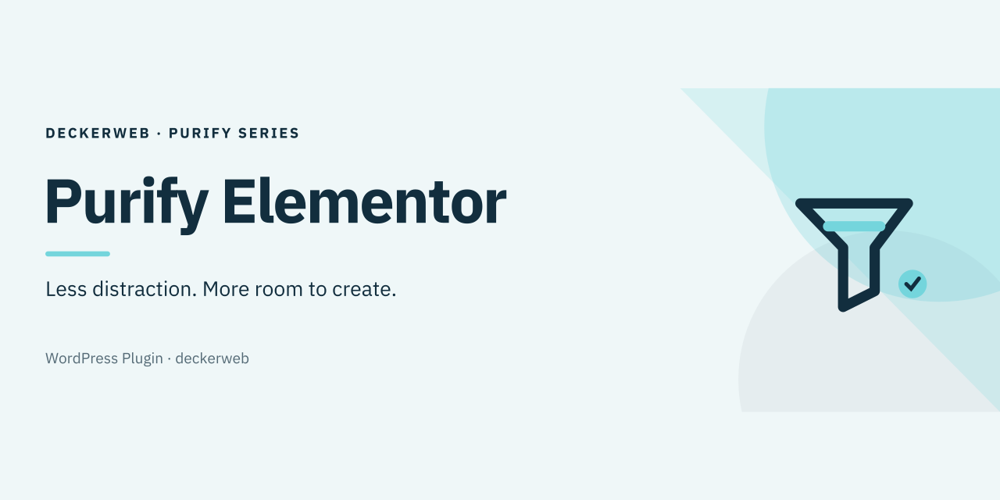

# Purify Elementor

A calmer Elementor workspace. Hide audited promotions and simplify navigation while keeping content and stored Elementor preferences intact.

[Deutsch](README.de.md) · Version 1.1.0 · WordPress 6.7+ · PHP 7.4+

[Download](https://github.com/deckerweb/purify-elementor/releases/latest) · [FAQ](docs/FAQ.en.md)

## Contents

- [At a glance](#at-a-glance)
- [Installation](#installation)
- [Features](#features)
- [Limits](#limits)
- [Components](#components)
- [External connections](#external-connections)
- [Data and Multisite](#data-and-multisite)
- [Snippet](#snippet)
- [FAQ](#faq)
- [Changelog](#changelog)
- [Author and support](#author-and-support)

## At a glance

- Eight website preferences under Settings → Purify Elementor.
- Home hidden by default; Account and MCP remain available.
- Optional locked-widget, AI, news and dashboard-widget controls.
- Compact localized header, accessible local changelog and documentation links.
- Read-only compatibility status and targeted MCP/Angie promotion cleanup.

## Installation

Upload the plugin ZIP under Plugins → Add New → Upload Plugin. Activate it and open Settings → Purify Elementor. Administrator permissions (manage_options) are required to change preferences. Missing or unaudited Elementor versions pause cleanup; settings remain accessible.

## Features

With Elementor Free, audited Pro-only menu entries and promotional Global Widgets surfaces are hidden. Global colors and fonts remain usable. Pro entry points are retained when Pro is loaded. Direct links open saved Templates, Add New Template, Settings and Element Manager; existing Elementor permissions still apply. With advertising cleanup enabled, audited Angie installation prompts, empty Custom Widget promotions, the Structure upgrade footer and MCP upgrade advertising are hidden. Active Angie tools, populated custom-widget categories and free MCP functions remain available. A compact status shows detected versions and whether cleanup is active, paused or disabled.

## Limits

Cleanup targets audited Elementor 4.3.3, 4.3.4 and 4.3.5 structures. Other versions pause cleanup to preserve functional controls. Atomic/V4 and third-party offers are not fully covered. No global suppression of technical, license, security or update notices. Hiding menus does not disconnect Account or MCP. No performance improvement is guaranteed. Pro 4.3.1 and 4.3.2 received source review and protection tests only; full live Pro compatibility is not established. The form workaround is limited to Purify settings with audited Elementor versions; it does not alter other forms or Elementor tracking globally.

## Components

The plugin embeds deckerweb Library 0.9.0 and GitHub Release Updater 2.1.0. Library runtime requires PHP 8.0; compatible runtime election checks requirements before include. Purify retains its PHP 7.4 minimum. Shared Library preferences and optional online discovery are separate from Purify preferences. No automatic updates or telemetry are enabled.

## External connections

Release metadata and chosen update ZIPs are requested from GitHub. Optional Library online discovery requests the deckerweb GitHub raw catalog; installation requires release and package validation. Endpoints see the requesting IP. No site URL, user ID or plugin inventory is submitted by the Library. Public use requires no token.

## Data and Multisite

The eight Purify preferences belong to each website, including in Multisite. Deactivation and uninstall retain them. Uninstall removes the host update cache and invokes the shared Library cleanup contract; another installed host, even inactive, protects shared data. Library settings remain unless its separate deletion option is enabled. Elementor data and installed catalog plugins are retained.

## Snippet

The explicitly authorized standalone snippet uses the same cleanup engine. Run it everywhere in a PHP snippet manager and activate only one variant. Home and the entire dashboard widget are hidden by default. It has code configuration instead of a settings page, and includes neither Library nor updater. Its own German fallback works without plugin language files; load timing depends on the manager.

## FAQ

**Where are the preferences?**

Settings → Purify Elementor, or the Settings link in the plugin list.

**Can I keep Home, Account and MCP?**

Yes. Home is initially hidden; Account and MCP are initially shown. Change their independent preferences without disconnecting services.

**Does this disable Elementor Pro?**

No. Pro widgets, content and license data are not removed. Audited Pro-only entry points are hidden only in Free.

**What happens after deactivation or uninstall?**

Purify preferences and Elementor data remain. Only temporary host/shared component data is cleaned according to ownership.

**Does it support every Elementor version and Multisite?**

Cleanup is limited to audited Elementor 4.3.3, 4.3.4 and 4.3.5. Preferences are per site; isolated Multisite checks do not establish full live Pro/network compatibility.

[FAQ by topic](docs/FAQ.en.md)

## Changelog

### 1.1.0 · October 14, 2026

- **New:** Compact compatibility status shows detected Elementor versions and whether cleanup is active or paused.
- **Improved:** Hides audited Angie installation promotions, empty Custom Widget advertising, Structure upsells and MCP upgrade advertising while retaining usable widgets and MCP features.
- **Improved:** Supports audited Elementor Free 4.3.4 and 4.3.5 alongside 4.3.3 and includes deckerweb Library 0.9.0.
- **Improved:** Localized Focus artwork uses IBM Plex Sans with self-contained vector outlines.
- **Fixed:** Admin notices remain below the complete header; saving produces one confirmation.
- **Fixed:** Scoped form compatibility avoids the Elementor dashboard-tracking error on the Purify settings page.
- **Fixed:** Editor cleanup pauses for unreviewed Elementor versions.
- **Fixed:** Footer dialogs remain closed under conflicting global styles and use isolated controls, native closing and keyboard focus return. The plugin changelog retains a direct link if its dialog is unavailable.

### 1.0.1 · October 2, 2026

- **Improved:** Compact deckerweb footer with version, changelog, documentation and author links.
- **Fixed:** Selected icon displayed in the admin header and localized banners displayed in both READMEs.

### 1.0.0 · October 2, 2026

- **New:** First public stable release with plugin ZIP and optional standalone snippet.
- **Improved:** GitHub release updates and localized artwork.

### 0.3.0 · October 2, 2026

- **New:** Direct admin links for Templates, Add New Template, Settings and Element Manager.
- **Improved:** Hide Pro-only navigation in Free; apply Account and MCP preferences to the internal sidebar.
- **Fixed:** Hide the top Upgrade button.

### 0.2.2 · October 2, 2026

- **New:** Hide Theme Builder and Global Widgets promotions in Free; preserve global colors and fonts.
- **Fixed:** Hide the empty Pro category with promotional widgets.

### 0.2.1 · October 2, 2026

- **Fixed:** Recognize Home URLs and remove late-registered Upgrade entries.

### 0.2.0 · October 2, 2026

- **New:** Independent Home, Account, MCP and dashboard-widget preferences; embedded deckerweb Library.
- **Fixed:** Reliable changelog close, Escape and focus handling.

## Author and support

Developer and publisher: David Decker – DECKERWEB. GitHub direct distribution; no WordPress.org build. [Issues](https://github.com/deckerweb/purify-elementor/issues) · [Security](SECURITY.md) · [Ko-fi](https://ko-fi.com/deckerweb) · [Buy Me a Coffee](https://buymeacoffee.com/daveshine) · [PayPal](https://paypal.me/deckerweb)

Copyright © 2026 David Decker – DECKERWEB. GPL-2.0-or-later. Embedded Library and updater are deckerweb components under the same license. Focus artwork: native SVG vector shapes and IBM Plex Sans glyph outlines (SIL OFL 1.1), without embedded raster images or external resources. [Font license](assets/artwork/licenses/OFL-IBM-Plex-Sans.txt).
